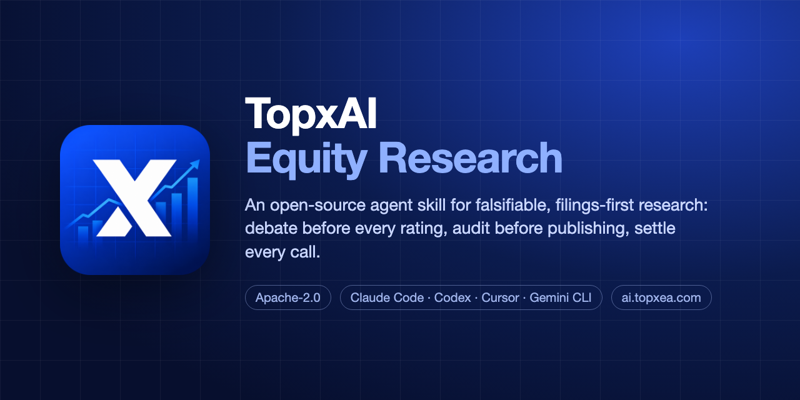

<p align="center">
  
</p>

# TopxAI Equity Research

An agent skill that runs a research desk: it takes a company, a value chain or a macro question from kickoff to a
finished report, makes every conclusion falsifiable, puts a bull/bear debate in front of every rating, audits the
draft adversarially, and then keeps a ledger that settles each call when it comes due.

It is built for research a professional reader would pay for. A report leads with one claim and its value per share,
argues it with facts dug out of primary records, and lets the reader check every source: each key number is footnoted
to the page with a link and an evidence grade, and the company's own documents are shown with the sentence boxed in red.
Valuation numbers come from one model file, and ratings are stated so they can be settled: twelve months, against a
named benchmark, from the publication-date close.

[中文说明](README.zh-CN.md) · Apache-2.0 · Made by [TopxAI](https://ai.topxea.com)

## What you get

- **A full research pipeline** in ten stages, each with its outputs and an exit gate: kickoff, research lanes,
  bull/bear debate, writing, tradable judgment, two audit rounds, publishing, coverage watch, settlement, updates.
- **A method, not a template.** Cause / process / outcome analysis, a first-principles layer, a transmission chain
  from liquidity to the single stock, consensus reconstruction from prices, mispricing evidence, catalyst paths,
  and an evidence-strength rule that stops weak inputs from carrying strong conclusions.
- **A report form built to be checked** (new in 1.1): the title is the claim with a per-share figure; at least three
  new facts from records beyond the 10-Q (8-K exhibits, regulatory dockets, court files, permits, the company's own
  earlier statements, measurements); sections ordered by the argument; every number footnoted to the page; screenshots of
  original documents with a red box; a body of at most 15,000 words.
- **Nine-step flows** for single-stock, industry / value-chain and macro reports.
- **An indicator and data-source library** (SEC EDGAR, FRED, BLS, Census, FINRA and more), each indicator tagged as a
  cause, a process or an outcome, and a **catalogue of measurement and accounting traps** found in real reports.
- **Five agents** for Claude Code and Cowork: research collector, bull, bear, auditor and translator. They cannot spawn
  their own subagents and hand back at most 120 words, so the editor's context stays clean. On agents without
  subagents, the main agent plays each role in turn.
- **Small tools** (Python 3.9+; all standard library except `exhibit.py`):
  - `sec.py`: the last eight quarters of revenue, margins, cash flow and capex, plus cash, debt, RPO and shares, from
    SEC XBRL. The raw multi-megabyte JSON stays in a cache; the agent sees about 3 KB.
  - `ledger.py`: an append-only ledger of calls with settlement, a lesson per settlement, and an honest hit rate.
  - `desk.py`: a coverage watch that matches new SEC filings to open falsifiers and lists calls coming due.
  - `check_report.py`: a form gate for the finished report: length, the title-page claim, footnotes with links and page
    locators, exhibits, sentences overloaded with numbers, internal codes leaking into the text.
  - `exhibit.py`: crops a passage out of a filing (PDF, or HTML printed through a local Chrome), boxes the sentence in
    red and reports the page to cite. Needs `pip install pymupdf`.
- **Templates** for the kickoff note, the source cross-check, the writing contract, audit decisions, final checks,
  ledger entries and the watch list, plus a disclosure template.

## Install

**Claude Code (plugin, includes the five agents)**

```
/plugin marketplace add UnbelievableT/topxai-equity-research
/plugin install topxai-equity-research@topxai
```

**Any agent that reads Agent Skills** (Claude Code, Codex, Cursor, Gemini CLI, OpenClaw and others, via
[skills.sh](https://skills.sh)):

```
npx skills add UnbelievableT/topxai-equity-research
```

**Manual**: download the package from [ai.topxea.com/labs](https://ai.topxea.com/labs) or from the
[GitHub releases](https://github.com/UnbelievableT/topxai-equity-research/releases), and copy
`skills/topxai-equity-research/` into your agent's skills folder (for Claude Code, `~/.claude/skills/`).

## First run

The SEC tool identifies you to the SEC, as its fair-access policy requires. The plugin asks for this when you enable
it; otherwise set it yourself:

```
export SEC_USER_AGENT="Jane Doe jane@example.com"
```

Then ask your agent, for example:

- "Write a deep-dive research report on NVDA."
- "Kick off an industry report on the AI data-center power chain."
- "Pull the last eight quarters for AMD from SEC filings."
- "Run the coverage watch and tell me which calls are due."
- "Settle call #12: the 10-Q is out."

The skill creates a `research/` folder in your project: one folder per report, plus `ledger.json`, `lessons.md`,
`patterns.md`, `watch.json` and the coverage watch output.

## How it works

```
1 Kickoff ─► 2 Research lanes ─► 2.5 Bull/bear debate ─► 3 Writing ─► 3.5 Tradable judgment
          ─► 4 Adversarial audit (2 rounds) ─► 5 Publish & register every call
          ─► Coverage watch ─► Settle (one lesson per call) ─► Update
```

The rules that matter most:

1. Real data only. If a number cannot be sourced, it says "not verified".
2. Evidence grades [A]–[D] on every key number; disagreements are shown, not resolved silently.
3. Every core conclusion says what would prove it wrong.
4. A conclusion is never stronger than its weakest load-bearing input.
5. Ratings are settleable, and every call is settled, including the ones that turn out wrong.

## Data, network and privacy

- `sec.py` and `desk.py` call only `https://www.sec.gov` and `https://data.sec.gov`, sending the `SEC_USER_AGENT` you
  provide. `exhibit.py` downloads only the document URL you pass it (with your `SEC_USER_AGENT` for sec.gov, a regular
  browser user agent elsewhere) and caches it under `research/cache/exhibits/`. Nothing else is sent anywhere.
- All files are written inside your project's `research/` folder. There is no telemetry and no account.
- Prices for the coverage watch come from a CSV you supply; the tools do not scrape market data.

## Not investment advice

This skill helps produce research. Its output is general information, not personalised investment advice, and not
an offer to buy or sell any security. Use the disclosure template in `skills/topxai-equity-research/assets/` for
anything you publish, and consult a licensed professional before acting on research.

## About TopxAI

TopxAI ([ai.topxea.com](https://ai.topxea.com)) gives developers Claude, GPT, Grok, GLM, Kimi, DeepSeek and image
and video models through one OpenAI- and Anthropic-compatible API, with fixed USD prices and prepaid credit. This
skill is the method behind the research published at [topxea.com/research](https://topxea.com/research), shared for
free. More free tools: [ai.topxea.com/labs](https://ai.topxea.com/labs).

Issues and suggestions: [GitHub issues](https://github.com/UnbelievableT/topxai-equity-research/issues).

## License

Apache License 2.0. See [LICENSE](LICENSE) and [NOTICE](NOTICE).
