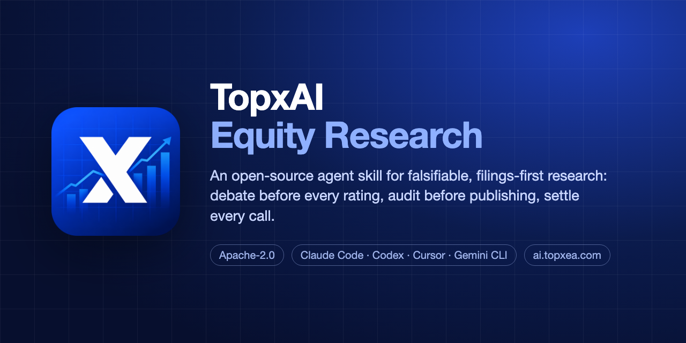

<p align="center">
  
</p>

# TopxAI Equity Research（中文说明）

这是一个给 AI agent 用的研报技能：一家公司、一条产业链或一个宏观问题，从立项一路做到成稿，
报告里的每一条判断再记进台账，到期逐条结算。

标准按专业读者愿意付钱的水平定：每个关键数字都能回到一手出处并标证据等级，估值只从一份模型文件里取数。
评级要能结算，写明 12 个月、对哪个基准、从发布日收盘起算；每条核心结论都写出「什么情况下我错了」。

英文说明见 [README.md](README.md)，以英文版为准。许可证 Apache-2.0，由 [TopxAI](https://ai.topxea.com) 制作并免费开放。

## 里面有什么

整条流水线分十段，每段写明产出文件和放行条件：立项、分路调研、多空辩论、撰写、可交易判断、两轮对抗式审计、
发布与登记、覆盖池值守、结算、更新。方法文件讲的是因果过程：市场和财报只是结果，报告要讲清机制怎么运转、
接下来会发生什么、靠哪些观测点判断自己错了。个股、产业链、宏观各有一套九步流程，另附指标与数据源库
（SEC EDGAR、FRED、BLS、Census、FINRA 等）和一份口径陷阱清单。

插件自带五个角色 agent：调研、多方、空方、审计、翻译。它们不能再派子 agent，交回主编的话限 120 个英文词，
主编的上下文里只留结论。不支持子 agent 的工具里，由主 agent 按顺序扮演这几个角色。

三个小工具只用 Python 标准库（3.9 及以上）:

- `sec.py` 从 SEC XBRL 取近八个季度的营收、利润、现金流和资本开支，以及现金、债务、RPO、股数。几 MB 的原始数据留在缓存里，agent 只看到约 3 KB。
- `ledger.py` 是只能追加的判断台账，结算时必须写证据和一句教训，命中率按「命中 ÷（命中 + 证伪）」算。
- `desk.py` 做覆盖池值守：把 SEC 新申报和台账里的证伪条件对上，列出快到期的判断。

## 安装

Claude Code（插件，含五个 agent）:

```
/plugin marketplace add UnbelievableT/topxai-equity-research
/plugin install topxai-equity-research@topxai
```

其他支持 Agent Skills 的工具（Codex、Cursor、Gemini CLI、OpenClaw 等），通过 [skills.sh](https://skills.sh) 安装：

```
npx skills add UnbelievableT/topxai-equity-research
```

也可以从 [ai.topxea.com/labs](https://ai.topxea.com/labs) 或 GitHub Releases 下载完整包，把 `skills/topxai-equity-research/`
复制到你的 agent 的技能目录(Claude Code 是 `~/.claude/skills/`)。

## 第一次用

SEC 要求请求方报上姓名和邮箱。插件启用时会弹出这一项，也可以手动设置：

```
export SEC_USER_AGENT="Zhang San zhangsan@example.com"
```

之后直接用自然语言下指令，比如「给 NVDA 写一份个股深度研报」「从 SEC 申报里取 AMD 近八个季度的数」
「跑一下值守，看哪些判断到期了」「结算 #12,10-Q 出来了」。

技能会在项目里建一个 `research/` 目录：每份报告一个子目录，另有 `ledger.json`、`lessons.md`、`patterns.md`、
`watch.json` 和值守记录。

## 联网与隐私

只有 `sec.py` 和 `desk.py` 会联网，只访问 `https://www.sec.gov` 和 `https://data.sec.gov`，发出去的只有填写的
`SEC_USER_AGENT`。所有文件都写在项目的 `research/` 目录里，没有遥测，也不需要注册账号。值守用到的价格由用户自备 CSV,
工具不抓行情数据。

## 不构成投资建议

这个技能用来辅助研究，产出是一般性的研究信息，不是针对个人的投资建议，也不是买卖任何证券的要约。
对外发布前请套用 `skills/topxai-equity-research/assets/` 里的披露模板；据此做投资决定前，请咨询持牌专业人士。

## 关于 TopxAI

TopxAI([ai.topxea.com](https://ai.topxea.com))用一个兼容 OpenAI 和 Anthropic 的接口提供 Claude、GPT、Grok、GLM、
Kimi、DeepSeek 以及图像和视频模型，美元定价，预付余额。[topxea.com/research](https://topxea.com/research) 上的研究报告
就是按这套方法做的，这里把方法免费公开。更多免费工具在 [ai.topxea.com/labs](https://ai.topxea.com/labs)。

问题和建议请提到 [GitHub issues](https://github.com/UnbelievableT/topxai-equity-research/issues)。
